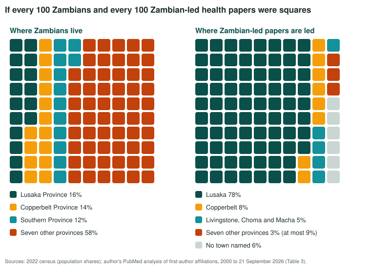
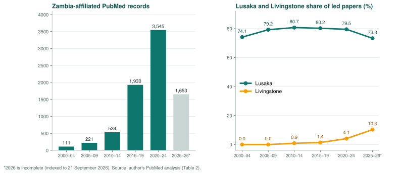

```{=html}
<div class="stat-strip">
  <div class="stat"><span class="num">83.9%</span><span class="lab">of 7,996 Zambia-affiliated PubMed records name Lusaka in an author's address</span></div>
  <div class="stat amber"><span class="num">78.4%</span><span class="lab">of Zambian-led papers have a first author based in Lusaka</span></div>
  <div class="stat rust"><span class="num">3.3%</span><span class="lab">are led from the seven provinces that hold 58.2% of the population</span></div>
  <div class="stat teal"><span class="num">32&times;</span><span class="lab">more records in 2020&ndash;24 than in 2000&ndash;04, with Lusaka's share unchanged</span></div>
</div>
```

## The pattern

Of the 7,996 records in the National Library of Medicine's PubMed database which were published from 2000 onwards and carry at least one Zambian institutional affiliation, 6,705 (83.9 per cent) name Lusaka somewhere in an author's address (Table 1). The capitals of the seven provinces which lie outside Lusaka, the Copperbelt and Southern Province, namely Kabwe, Chipata, Kasama, Mansa, Chinsali, Solwezi and Mongu, appear on only 186 records between them, and only 77 of those carry no Lusaka affiliation alongside. Those seven provinces are home to 58.2 per cent of Zambians (Zambia Statistics Agency, 2022), and yet their provincial capitals stand on their own on roughly one Zambian paper in a hundred.

Counting every author's address flatters Lusaka to some extent, since a multi-site paper with a single Lusaka co-author is credited to the capital, and so we also read the address of the first author on each record. Only 3,166 records (39.6 per cent) are led by a first author based in Zambia at all, which deserves attention in its own right. Of these, 2,482 (78.4 per cent) are led from Lusaka, 247 (7.8 per cent) from the Copperbelt, 124 (3.9 per cent) from Livingstone and 33 (1.0 per cent) from Choma and Macha (Table 2). A first author whose address names a town in one of the seven remaining provinces leads only 105 of these papers (3.3 per cent). Even if every paper whose address names no town at all were assigned to those provinces, their share would not reach 9 per cent, which is a long way from the 58.2 per cent of the population they hold (Table 3).

{fig-alt="Two grids of 100 squares. Of every 100 Zambians, 16 live in Lusaka Province, 14 in the Copperbelt, 12 in Southern Province and 58 in the seven other provinces. Of every 100 Zambian-led health papers, 78 are led from Lusaka, 8 from the Copperbelt, 5 from Livingstone, Choma and Macha, 3 from the seven other provinces and 6 name no town."}

::: {.fig-caption}
**Figure 1.** Population share (2022 census) against share of Zambian-led papers since 2000, by the town named in the first author's affiliation. The seven-province share of papers is at most 9 per cent even if every record with no town were assigned to those provinces.
:::

## Infrastructure, and growth that did not equalise

The publication pattern follows the infrastructure. All but two of the medical schools we could identify are in Lusaka, the exceptions being the Copperbelt University's Michael Chilufya Sata School of Medicine in Ndola and Mulungushi University's School of Medicine and Health Sciences in Livingstone, and none is in the seven provinces. The University Teaching Hospital, the Centre for Infectious Disease Research in Zambia, Zambart, the Levy Mwanawasa Medical University and the National Health Research Authority all give Lusaka as their address, as their own affiliation lines in PubMed confirm thousands of times over. The Authority's Zambia Health Research Conference, first held in 2003 and convened every two years since (National Health Research Authority, n.d.), met at the Mulungushi International Conference Centre in Lusaka in both 2022 and 2024 (National Health Research Authority, 2022; Tropical Diseases Research Centre, 2024). A researcher in Chipata or Mongu who wanted a seat at that table has had to travel to the capital to get one.

Zambia-affiliated output rose more than thirtyfold between the first and the most recent full five-year windows, from 111 records in 2000 to 2004 to 3,545 in 2020 to 2024. And yet the proportion of Zambian-led papers with a Lusaka first author went from 74.1 per cent in the first window to between 79 and 81 per cent in every window from 2005 to 2024 (Table 2). Growth on this scale has therefore not been the equaliser one might have expected it to be. The first real movement appears only in 2025 and 2026, when Lusaka's share falls to 73.3 per cent while Livingstone's rises to 10.3 per cent, and the affiliation lines behind that rise are dominated by Mulungushi University's School of Medicine and Health Sciences. We read this with caution as two years is a short window and the 2026 records are still incomplete, but it is the clearest sign in the data that publications follow where a medical school is put.

{fig-alt="Left: bar chart of Zambia-affiliated PubMed records per five-year window, rising from 111 in 2000 to 2004 to 3,545 in 2020 to 2024, with 1,653 so far in 2025 to 2026. Right: line chart showing Lusaka's share of Zambian-led papers between 74 and 81 per cent in every window until 2025 to 2026, when it falls to 73.3 per cent, while Livingstone's share rises from zero to 10.3 per cent."}

::: {.fig-caption}
**Figure 2.** Output grew more than thirtyfold, yet Lusaka's share of Zambian-led papers held at 79 to 81 per cent in every window from 2005 to 2024. The first real movement is in 2025 to 2026, where Livingstone's share rises to 10.3 per cent.
:::

## Why the geography matters

Malama et al. (2021), in their qualitative case study of how health research is translated into policy in Zambia, describe the mechanism which links this concentration to policy. Some of the researchers and policymakers they interviewed reported that research is conducted in many parts of the country but only research from key provinces such as Lusaka and Copperbelt may come to the attention of policymakers, while findings from other districts, however important, may receive less attention. Their participants also pointed out that Zambia lacked a national knowledge hub for health research generated locally. The irony, which the authors do not dwell on, is that their own study was conducted in Lusaka because, as they explain, that is where most national policymakers and public health researchers are based. We do not offer this as a criticism of the authors but as a demonstration of how completely visibility, funding and policy access have come to sit in one place.

It would be a mistake to read any of this as evidence of something peculiar to Lusaka's institutions or the researchers who work in them, since national funding, the best-resourced campuses, the busiest teaching hospitals and the ministries which commission and consume research tend to cluster in a capital almost by definition. Mozambique shows the same geography at the level of institutions, where 22 of its 56 higher education institutions (39.3 per cent) are in Maputo City and 38 (67.9 per cent) are in the southern region (Chissaque et al., 2024). However, we have not found a within-country analysis of publication output comparable to ours for any other country in the region, and that gap is itself worth filling. None of this is a personal failing on the part of researchers in Kabwe, Chipata, Solwezi or Mansa, as it is simply what happens when a system quietly builds its scaffolding around one address.

```{=html}
<figure class="loop">
  <ol class="loop-steps">
    <li><span class="n">1</span><strong>Resources cluster</strong><span>National funding, the best-resourced campuses, the busiest teaching hospitals and the ministries that commission and consume research sit in the capital.</span></li>
    <li><span class="n">2</span><strong>Research is produced there</strong><span>83.9% of records name Lusaka, and 78.4% of Zambian-led papers have a Lusaka first author.</span></li>
    <li><span class="n">3</span><strong>Policy sees what is near</strong><span>Research from key provinces such as Lusaka and the Copperbelt reaches policymakers more easily (Malama et al., 2021).</span></li>
    <li><span class="n">4</span><strong>Evidence fits the capital</strong><span>Lusaka is 81.5% urban in a country that is 60.0% rural, with very different malaria burdens.</span></li>
    <li><span class="n">5</span><strong>Provincial careers stall</strong><span>Without workshops, committees or nearby co-investigators, fewer researchers elsewhere produce evidence, and the cycle repeats.</span></li>
  </ol>
  <figcaption><strong>Figure 3.</strong> The argument as a feedback loop. This is a schematic of the reasoning in the text, not an empirical model.</figcaption>
</figure>
```

Health data collected in Lusaka, however well analysed, describe a province which is 81.5 per cent urban in a country which is 60.0 per cent rural, and where more than 80 per cent of the people of Western, Eastern, Luapula and Muchinga Provinces live in rural areas (Zambia Statistics Agency, 2022). Malaria makes the difference concrete, as the 2021 Malaria Indicator Survey recorded rapid diagnostic test prevalence of 3.3 per cent in Lusaka Province against 40 to 63 per cent in Luapula, Northern, Muchinga, North-Western and Western Provinces (U.S. President's Malaria Initiative, 2023). These are the very provinces whose researchers barely register in Table 2. When policy is built substantially from evidence generated in and about the capital, it risks fitting the capital rather better than the country it is meant to serve. Meanwhile, capacity starves where it is not fed. A lecturer at a provincial institution who cannot easily reach a workshop, sit on a national research committee or find a co-investigator nearby is a lecturer whose research career stalls whatever their ability, and each career that stalls is one fewer source of the very evidence the rest of the country needs.

```{=html}
<div class="contrast">
  <div class="contrast-head">Malaria makes the difference concrete</div>
  <div class="contrast-body">
    <div class="side low"><span class="big">3.3%</span><span class="cap">rapid diagnostic test prevalence, Lusaka Province</span></div>
    <div class="vs">vs</div>
    <div class="side high"><span class="big">40&ndash;63%</span><span class="cap">Luapula, Northern, Muchinga, North-Western and Western Provinces</span></div>
  </div>
  <div class="contrast-foot">2021 Malaria Indicator Survey (U.S. President's Malaria Initiative, 2023)</div>
</div>
```

## What could change

We do not think the answer is to relocate institutions wholesale, which is neither realistic nor obviously desirable given the efficiencies of concentrating scarce expertise, but rather to stop treating Lusaka's centrality as a neutral fact of geography and to start treating it as a policy choice with policy remedies. The National Health Research Authority and its funding partners could weight grant calls, even modestly, towards teams led from outside Lusaka and the Copperbelt. The Authority has already moved the twelfth Zambia Health Research Conference to Livingstone for December 2026 (National Health Research Authority, 2026), which shows that the conference can travel. A rotation which reaches Kasama, Mongu or Solwezi, with hybrid participation taken seriously enough that a provincial lecturer is not choosing between transport costs and a seat in the room, would carry that further. In ethics review, the registration of the Copperbelt University Biomedical Research Ethics Committee in Ndola in 2021 (Copperbelt University, n.d.) and the ethics committee of the Tropical Diseases Research Centre, also in Ndola (Health Research Web, n.d.), show that review capacity can be built away from Lusaka, where the next step is to extend it to the provincial hospitals of the seven provinces. None of these is a large ask on its own, and together with the medical school effect which the Livingstone figures hint at, they would begin to correct a pattern which, on the evidence since 2000, does not correct itself.

```{=html}
<div class="remedies">
  <div class="remedy"><span class="r-num">1</span><h3>Weight the grant calls</h3><p>Even modestly, towards teams led from outside Lusaka and the Copperbelt.</p></div>
  <div class="remedy"><span class="r-num">2</span><h3>Let the conference travel</h3><p>The 12th Zambia Health Research Conference moves to Livingstone in December 2026. A rotation to Kasama, Mongu or Solwezi, with real hybrid participation, would carry that further.</p></div>
  <div class="remedy"><span class="r-num">3</span><h3>Extend ethics review</h3><p>CBU-BREC (Ndola, 2021) and the TDRC committee show review capacity can be built outside Lusaka. The next step is the provincial hospitals of the seven provinces.</p></div>
</div>
```

## Data and method

All counts were re-run on 21 September 2026 through the NCBI E-utilities interface (National Center for Biotechnology Information, 2026). The base query was `Zambia[ad] AND 2000:3000[dp]`, which returned 7,996 records. Location counts in Table 1 use the PubMed affiliation field for any author. For Table 2, the full records were downloaded and the first author's affiliation lines were read directly; a record was counted as Zambian-led when the first author's affiliation ended in Zambia, with obvious false positives such as the Rwanda Zambia HIV Research Group (Kigali) and Zambia Street (Addis Ababa) excluded.

Before 1 October 2013, NLM recorded the affiliation of the first author only (National Library of Medicine, 2013). Any-author counts from before and after 2014 therefore measure different things, and the first-author series in Table 2 is the only measure that is consistent across the whole period.

<details class="data-tables">
<summary>Data tables 1 to 3</summary>

**Table 1.** Zambia-affiliated PubMed records, 2000 to 21 September 2026, by location named in any author's affiliation

| Location named in affiliation field | Records | Share of 7,996 |
|:---|---:|---:|
| Lusaka | 6,705 | 83.9% |
| Copperbelt cluster (Ndola, Kitwe, Luanshya, Chingola, Mufulira, Chililabombwe, Kalulushi or 'Copperbelt') | 841 | 10.5% |
| Choma or Macha | 274 | 3.4% |
| Livingstone | 221 | 2.8% |
| Any of the seven provincial capitals (Kabwe, Chipata, Kasama, Mansa, Chinsali, Solwezi, Mongu) | 186 | 2.3% |
| of which with no Lusaka affiliation on the record | 77 | 1.0% |
| None of Lusaka, Copperbelt, Choma/Macha or Livingstone (residual) | 588 | 7.4% |

*Rows overlap except the residual, since a multi-site paper can name more than one location. Individual capitals: Kabwe 88, Chipata 30, Kasama 18, Mansa 17, Chinsali 13, Solwezi 12, Mongu 12.*

**Table 2.** Location of Zambia-based first authors by five-year window (strict matching of the town named in the first author's affiliation)

| Window | All records | Zambian-led (n) | Lusaka | Copperbelt | Livingstone | Choma/Macha | Seven provinces | No town named |
|:---|---:|---:|---:|---:|---:|---:|---:|---:|
| 2000–2004 | 111 | 108 | 74.1% | 9.3% | 0.0% | 0.9% | 8.3% | 7.4% |
| 2005–2009 | 221 | 212 | 79.2% | 4.7% | 0.0% | 1.9% | 2.4% | 11.8% |
| 2010–2014 | 534 | 342 | 80.7% | 7.3% | 0.9% | 2.6% | 1.5% | 7.0% |
| 2015–2019 | 1,930 | 696 | 80.2% | 6.0% | 1.4% | 1.4% | 4.0% | 6.9% |
| 2020–2024 | 3,545 | 1,217 | 79.5% | 9.4% | 4.1% | 0.6% | 2.6% | 3.8% |
| 2025–2026\* | 1,653 | 591 | 73.3% | 7.6% | 10.3% | 0.3% | 4.4% | 4.1% |
| All | 7,994 | 3,166 | 78.4% | 7.8% | 3.9% | 1.0% | 3.3% | 5.5% |

*\*2026 is incomplete (indexed to 21 September 2026). Windows use the journal issue year, so totals differ slightly from [dp] counts; two records had no parsable year. 'Seven provinces' counts first authors whose affiliation names a town we could place in Central, Eastern, Luapula, Muchinga, Northern, North-Western or Western Province (for example Kabwe, Mkushi, Chipata, Mfuwe, Mansa, Chinsali, Mpika, Kasama, Mbala, Solwezi, Chitokoloki, Mongu, Kaoma); the town list is not exhaustive, so this is a floor. 'No town named' includes many Lusaka institutions (University of Zambia, CIDRZ, Zambart) whose affiliation lines omit the city; assigning those to Lusaka raises its overall share to 80.8 per cent.*

**Table 3.** Share of population (2022 census) against share of Zambian-led papers since 2000

| Area | Share of population, 2022 | Share of Zambian-led papers |
|:---|---:|---:|
| Lusaka Province (papers: Lusaka named) | 15.7% | 78.4% |
| Copperbelt Province | 14.1% | 7.8% |
| Southern Province (papers: Livingstone, Choma, Macha) | 12.1% | 4.9% |
| Central, Eastern, Luapula, Muchinga, Northern, North-Western and Western | 58.2% | 3.3% (at most 8.8%) |
| No town named | – | 5.5% |

*Population shares from the 2022 census preliminary report, Figure 3.6 (Zambia Statistics Agency, 2022). The upper bound of 8.8 per cent assumes every 'no town named' record belongs to the seven provinces, which is certainly an overstatement.*

</details>

## References

::: {.references-list}

Chissaque, A., Guimarães, E., Limaymanta, C. H., Conjo, C., Sebastião Capece, B. P., Gonçalves, L., de Deus, N., & Craveiro, I. (2024). Post-independence health research productivity in Portuguese-speaking African countries: A bibliometric analysis of 43 years of research and higher education in Mozambique. *Heliyon, 10*(15), e35767. https://doi.org/10.1016/j.heliyon.2024.e35767

Copperbelt University. (n.d.). *The Copperbelt University Biomedical Research Ethics Committee (CBU-BREC)*. Directorate of Research. Retrieved 21 September 2026, from https://www.cbu.ac.zm/schoolsAndUnits/dric/the-copperbelt-university-biomedical-research-ethics-committee-cbu-brec/

Health Research Web. (n.d.). *Tropical Diseases Research Centre (TDRC) Ethics Review Committee, Zambia*. Retrieved 21 September 2026, from https://healthresearchwebafrica.org.za/en/zambia/ethics_1007

Malama, A., Zulu, J. M., Nzala, S., Kombe, M. M., & Silumbwe, A. (2021). Health research knowledge translation into policy in Zambia: Policy-maker and researcher perspectives. *Health Research Policy and Systems, 19*, 42. https://doi.org/10.1186/s12961-020-00650-5

National Center for Biotechnology Information. (2026). *PubMed* [Database]. National Library of Medicine. Retrieved 21 September 2026, from https://pubmed.ncbi.nlm.nih.gov/

National Health Research Authority. (n.d.). *History of Zambia Health Research Conferences*. Retrieved 21 September 2026, from https://www.nhra.org.zm/history-of-zambia-health-research-conferences

National Health Research Authority. (2022). *10th Zambia Health Research Conference: Scientific programme, Mulungushi International Conference Centre, Lusaka, 19–21 October 2022*. https://nationalhealthresearchauthorit-rlj6.squarespace.com/s/Final-Programme-Zambia-Health-Research-Conference-2022-V2.pdf

National Health Research Authority. (2026). *12th Zambia Health Research Conference, 2–4 December 2026, Livingstone*. Retrieved 21 September 2026, from https://zhrc.nhra.org.zm/

National Library of Medicine. (2013). Changes coming to author affiliations. *NLM Technical Bulletin*, September–October 2013. https://www.nlm.nih.gov/pubs/techbull/so13/brief/so13_author_affiliations.html

Tropical Diseases Research Centre. (2024). *11th Zambia Health Research Conference*. Retrieved 21 September 2026, from https://www.tdrc.org.zm/?p=5219

U.S. President's Malaria Initiative. (2023). *Zambia malaria profile* (last updated 15 June 2023). https://mesamalaria.org/wp-content/uploads/2025/04/ZAMBIA-Malaria-Profile-PMI-FY-2024.pdf

Zambia Statistics Agency. (2022). *2022 Census of Population and Housing: Preliminary report*. Zambia Statistics Agency.

:::
